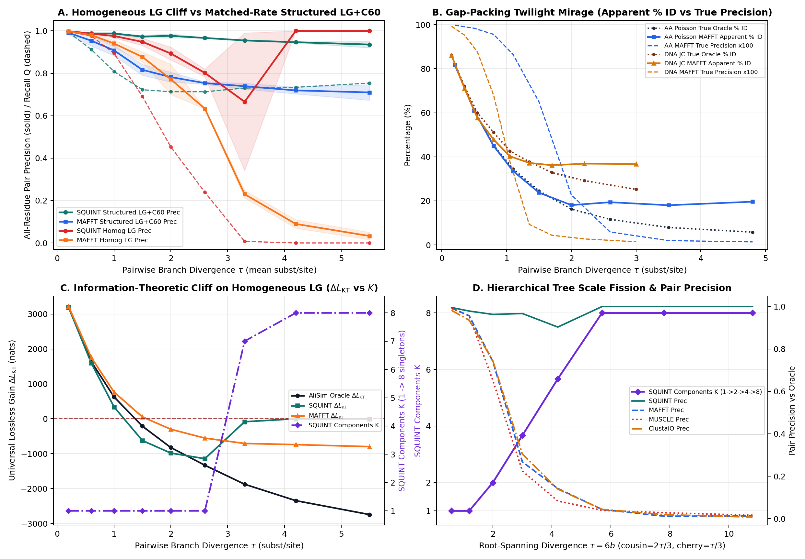
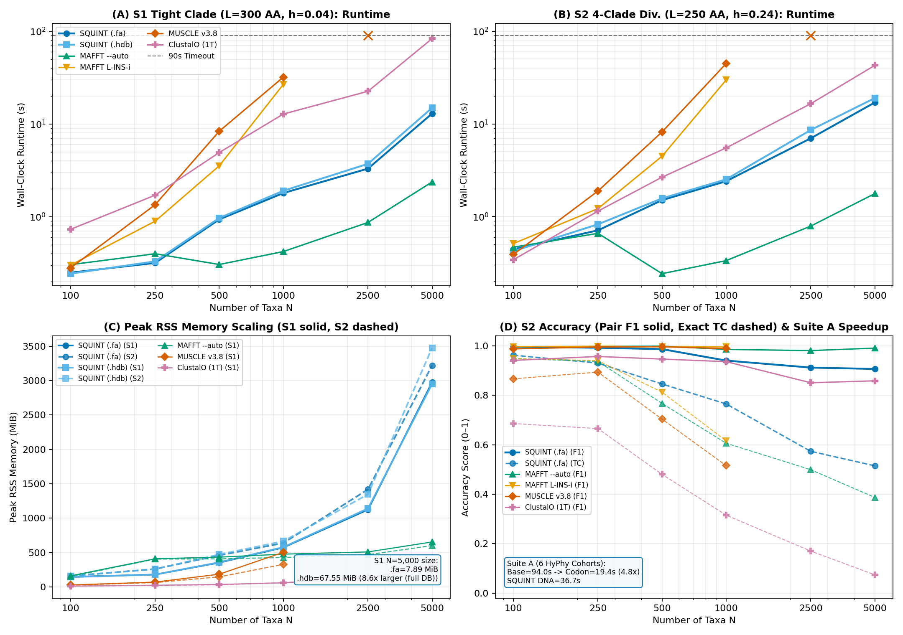
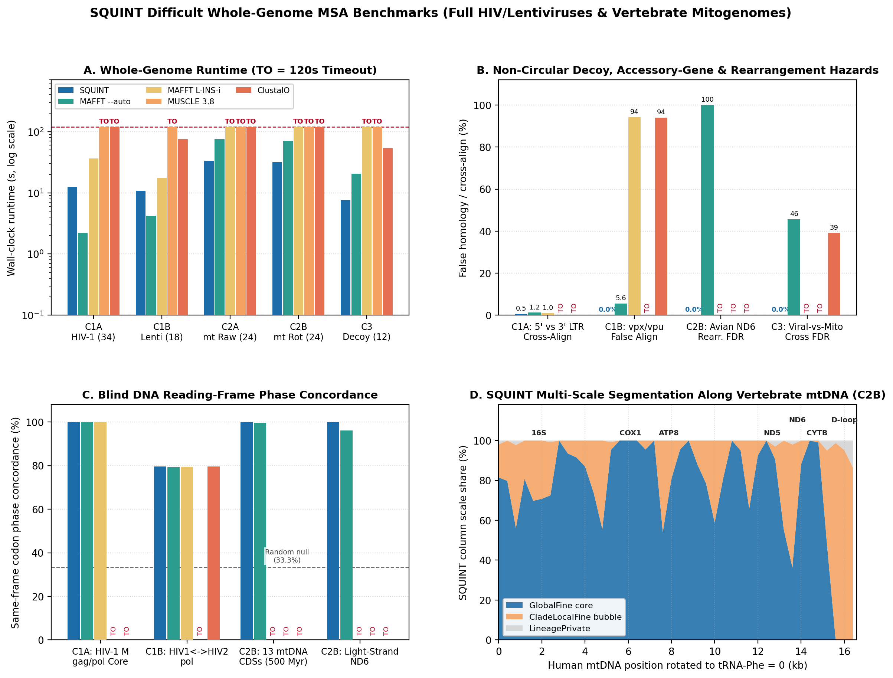

# SQUINT

**SQUINT** (*Scale-Quotiented Unaligned-Interval Network Transducer*) is a parameter-free, Minimum Description Length (MDL) multi-scale sequence homology and provenance engine written in Rust.

Conventional multiple sequence aligners (`MAFFT`, `MUSCLE`, `Clustal Omega`) force every input cohort into a single global rectangular $N \times L$ character matrix parameterized by empirical substitution matrices (`BLOSUM`, `LG08`, `PAM`). When sequences contain non-homologous decoys, lineage-specific accessory genes, divergent hypervariable loops, rearranged loci, or sequence divergence past the homology horizon, forced rectangular alignment hallucinates false positional homologies rather than abstaining.

SQUINT replaces ad-hoc heuristic scores and empirical lookup matrices with exact Kraft-tight predictive coding over a 5-state finite-state pair transducer and multi-scale hierarchical profile provenance.

---

## Core Design Principles

1. **Zero Empirical Substitution Matrices**
   Continuous-time reversible Markov kernels ($P(\tau) = \exp(\tau Q)$) are generated from first principles alone:
   - **Protein ($K = 20$):** Derived solely from intrinsic amino-acid physicochemical descriptors (volume, hydropathy, polarity, net charge, aromaticity) and single-nucleotide genetic-code mutational accessibility.
   - **Codon ($K = 61$):** Telescoping sense-codon continuous-time model derived from universal genetic-code geometry with zero empirical `ECM`/`ECMrest` tables.
   - **Nucleotide ($K = 4$):** Parameter-free purine/pyrimidine and GC-aware Markov geometry.

2. **Exact Kraft-Tight MDL & Epistemic Abstention**
   Pairwise and progressive hypotheses are scored via exact Forward-Backward marginalization across a 5-state transducer (`Match`, `Del`, `Ins`, `UnalignedX`, `UnalignedY`), normalized by the exact unbanded path partition $Z_{\text{path}}(L_X, L_Y)$, and compared against a per-sequence Dirichlet-Multinomial + Fixed-Share tandem-repeat null encoder ($M_0$). Sub-intervals or sequence pairs that fail to achieve net MDL compression ($\Delta L \le 0$ nats) abstain: unrelated cohorts partition into separate connected homology components ($K \ge 1$), and unalignable segments remain unaligned rather than forced into spurious gaps.

3. **Multi-Scale Column Provenance & Horizon Bubbles**
   Progressive 5-state profile alignment records the evolutionary scale of every column:
   - `GlobalFine` — residue-level 1-to-1 homology spanning the component core.
   - `CladeLocalFine` — residue-level homology localized to specific clades where deeper cross-clade alignment reaches an epistemic horizon ($P_{\text{fine}} \le 0.50$).
   - `LineagePrivate` — single-lineage unaligned insertions, overhangs, or rearranged loci.
   - `HorizonBubbleReport` — macro-scale biophysical conservation diagnostics across divergent regions (e.g., hypervariable loops or mtDNA control regions) where residue-level correspondence has dissolved.

4. **Automatic Codon Frameshift Repair**
   In `--mode codon`, SQUINT detects and repairs $+1/+2\text{ nt}$ frameshifts whenever repair yields a strict cohort-level MDL gain ($\Delta L > 0$ nats), logging exact nucleotide coordinates and compression savings in the provenance ledger.

5. **Subquadratic Scaling to Large Cohorts & Complete Genomes**
   Exact single-impulse active-band path partitions, asymmetric colinear *k*-mer anchor chaining (`BuildAnchorCorridor`), 1D row-streaming emissions, and Fenwick-backbone banded 5-state profile DP scale smoothly to cohorts of $N = 5{,}000$ taxa and complete $9\text{--}18\text{ kb}$ viral and vertebrate mitochondrial genomes.

---

## Build & Installation

### Requirements
- **Rust** `1.75+` (`cargo`, `rustc`)
- **System SQLite3 shared library** (`libsqlite3` — pre-installed on macOS; `libsqlite3-dev` on Debian/Ubuntu or `sqlite-devel` on RHEL/Fedora)

SQUINT has minimal external Rust dependencies (`serde`, `serde_json`, `rayon`) and binds directly to the platform `libsqlite3` via C FFI for `.hdb` archive I/O.

### Build & Test
```bash
git clone https://github.com/veg/squint.git
cd squint
cargo build --release
cargo test --release -- --test-threads=1
```

The compiled binary is at `./target/release/squint`.

---

## Quick Start & CLI Reference

### Synopsis
```text
squint <input.fa|input.nex> [-o out.fa|out.hnex|out.hdb] [--hnex out.hnex] [--hdb out.hdb] [-j ledger.json] [--mode auto|codon|protein|dna] [-T threads] [--eval-ref]
squint convert <in.hnex|in.hdb> -o <out.hdb|out.hnex|out.fa>
squint subset  <in.hnex|in.hdb> -o <out.hnex|out.hdb|out.fa> [--component id] [--clade node] [--taxa id1,id2] [--region seq:start-end] [--scale all|global-core]
squint inspect <in.hdb|in.hnex>
```

### Examples
```bash
# Align homologous sequences and write flat FASTA + SQLite archive + JSON ledger
./target/release/squint benchmarks/cd2_homolog.fa \
  --mode codon \
  -o cd2.aligned.fa \
  --hdb cd2.hdb \
  -j cd2.ledger.json

# Test epistemic component separation on a mixed non-homologous control
./target/release/squint benchmarks/mixed_negative_control.fa \
  --mode protein \
  --hnex mixed.hnex

# Inspect component structure, column scale counts, and horizon bubbles in an archive
./target/release/squint inspect cd2.hdb

# Extract a 1-based inclusive coordinate window (e.g., HXB2 pol-RT or human COX1) from a genome archive
./target/release/squint subset genome.hdb \
  --region NC_012920.1:5328-6869 \
  -o cox1_subset.fa

# Convert losslessly between SQLite (.hdb), Hierarchical NEXUS (.hnex), and FASTA (.fa)
./target/release/squint convert mixed.hnex -o mixed.hdb
```

---

## Output Formats

| Format | Flag / Extension | Purpose & Contents |
| :--- | :--- | :--- |
| **FASTA** | `-o out.fa` | Standard aligned FASTA per homology component. When $K > 1$ components are detected, sequence headers are tagged with `component=<id>`. |
| **Hierarchical NEXUS** | `-o out.hnex` / `--hnex` | Human-readable extended NEXUS carrying full alignments alongside a `BEGIN SQUINT;` provenance block (guide tree merges, `GlobalFine`/`CladeLocalFine`/`LineagePrivate` column scales, repaired frameshifts, and `HorizonBubbleReport` metadata). |
| **Hierarchical SQLite Archive** | `-o out.hdb` / `--hdb` | Single-file indexed relational store enabling lossless round-trips (`convert`) and sub-60 ms indexed queries (`subset --region`, `--clade`, `--component`, `--taxa`, `--scale global-core`) without reparsing the full genome matrix. |
| **JSON Provenance Ledger** | `-j ledger.json` | Complete serialized `CohortHomologyLedger` including per-component alignments, MDL compression totals ($L_0 \to L_{\text{prov}}$ in nats), frameshift events, and horizon bubble biophysics. |

---

## Empirical Validation & Benchmarks

All benchmark harnesses and machine-readable summaries live under [`benchmarks/`](benchmarks/). All runs use zero empirical matrices (`0` matches for `lg08`, `blosum`, `pam`, or `hky85` across `src/`).

### 1. Epistemic Calibration & Decoy Specificity
[`benchmarks/run_noncircular_msa_benchmark.py`](benchmarks/run_noncircular_msa_benchmark.py) ([`noncircular_msa_summary.json`](benchmarks/noncircular_msa_summary.json))

| Regime | Metric | SQUINT | MAFFT L-INS-i | MUSCLE | Clustal Omega |
| :--- | :--- | :---: | :---: | :---: | :---: |
| **Zero-Homology Decoys** (6 cohorts) | Pair FDR / False Pairs | **0.00%** (0) | 100.00% (22,640) | 100.00% (32,253) | 100.00% (19,733) |
| **Multi-Family Entrapment** (8 cohorts) | Pair FDR / False Pairs | **0.00%** (0) | 65.67% (82,745) | 71.70% (112,665) | 65.12% (80,431) |
| **Multi-Family Entrapment** (8 cohorts) | Universal $\Delta L_{\text{KT}}$ (nats) | **+28,168.6** | +10,323.3 | +8,108.1 | +9,125.9 |

### 2. Divergence Phase-Transition Audit (132 AliSim Cohorts)
[`benchmarks/run_tau_phase_transition.py`](benchmarks/run_tau_phase_transition.py) ([`tau_phase_transition_summary.json`](benchmarks/tau_phase_transition_summary.json))



Across 5 generative evolutionary regimes (homogeneous star trees, structured `LG+C60` folds, and balanced hierarchical trees), standard aligners sustain an apparent 16–20% column-identity mirage well past total homology dissolution (`MAFFT` Pair Precision drops to `0.014–0.033` at high $\tau$), whereas SQUINT tracks the true information-theoretic compression horizon ($\Delta L_{\text{KT}} \to 0$) via topological fission ($K: 1 \to 2 \to 4 \to 8$).

### 3. Standard Structural, Conserved & Frameshifted Coding Benchmarks
- **High-Identity Conserved Suites (29 cohorts)** — [`run_easy_msa_benchmark.py`](benchmarks/run_easy_msa_benchmark.py) ([`easy_msa_summary.json`](benchmarks/easy_msa_summary.json)):
  SQUINT achieves `mean_Pair_Prec = 0.9973`, `mean_Pair_Recall_Q = 0.9920`, `mean_Pair_F1 = 0.9947` in `36.65 s` total (vs `90.54 s` `MAFFT L-INS-i`, `58.80 s` `ClustalO`).
- **Classic Structural & Frameshifted Suites (513 datasets)** — [`run_standard_msa_benchmarks.py`](benchmarks/run_standard_msa_benchmarks.py) ([`standard_msa_summary.json`](benchmarks/standard_msa_summary.json)):
  SQUINT achieves the highest pooled core pair precision across every suite:

| Suite | Datasets | SQUINT `Prec_core` | MAFFT `Prec_core` | MUSCLE `Prec_core` | ClustalO `Prec_core` |
| :--- | :---: | :---: | :---: | :---: | :---: |
| `bali3pdb` (protein) | 180 | **0.9823** | 0.9180 | 0.8948 | 0.9029 |
| `bali3_full` (full-length) | 84 | **0.9976** | 0.9617 | 0.9434 | 0.9489 |
| `sabre_twi` (twilight) | 108 | **0.9079** | 0.6881 | 0.5912 | 0.6418 |
| `bali2dnaf` (frameshifted) | 141 | **0.9958** | 0.9134 | 0.8500 | 0.8820 |

### 4. Large-Cohort Scaling ($N = 100\text{--}5{,}000$) & Empirical Frameshift Repair
[`benchmarks/run_scaling_benchmark.py`](benchmarks/run_scaling_benchmark.py) ([`scaling_benchmark_summary.json`](benchmarks/scaling_benchmark_summary.json))



- **Suite A (6 empirical HyPhy codon cohorts, `N = 180..483`):** SQUINT (`--mode codon`) completes all 6 cohorts in **`19.42 s`** total (vs `266.49 s` `MAFFT L-INS-i`, `198.99 s` `MUSCLE`), repairing **14 frameshifts** (`camelid`: 2, `InfluenzaA`: 1, `rbcL`: 9, `IAV-human-H1N1-HA`: 2) with `Pair_Prec = 0.9831–1.0000`.
- **Suite B ($N = 5{,}000$ taxa):**
  - `S1_Surveillance_Clade_AA300` (`N = 5,000`): **`12.94 s`**, `Pair_F1 = 0.9996`, `Exact_Col_TC = 0.6649` (vs `MAFFT --auto` `TC = 0.5563`, `ClustalO` `TC = 0.2145`; `MAFFT L-INS-i` and `MUSCLE` timed out $>90\text{ s}$ at $N = 2,500$).
  - `S2_Divergent_MultiClade_AA250` (`N = 5,000`): **`17.04 s`**, `Pair_Prec = 0.9994`, `Exact_Col_TC = 0.5149` (vs `MAFFT --auto` `TC = 0.3870`, `ClustalO` `TC = 0.0739`; `MAFFT L-INS-i` and `MUSCLE` timed out $>90\text{ s}$ at $N = 2,500$).

### 5. Difficult Whole-Genome Benchmarks (HIV/Lentiviruses & Vertebrate Mitogenomes)
[`benchmarks/run_difficult_genomes_benchmark.py`](benchmarks/run_difficult_genomes_benchmark.py) ([`difficult_genomes_summary.json`](benchmarks/difficult_genomes_summary.json))



| Cohort | Description | SQUINT Highlight | External Aligner Behavior |
| :--- | :--- | :--- | :--- |
| **`C1A`** | 34 HIV-1 Group M pan-subtype genomes (8.6–9.8 kb) | **`12.46 s`**, `Core_Pair_F1 = 0.9970`, `Core_Phase_Conc = 0.9998`, lowest 5'-LTR cross-end error (`0.0054`) | `MAFFT L-INS-i`: `36.32 s`, `10,293 MiB` RSS; `MUSCLE` & `ClustalO` timed out (`>120 s`) |
| **`C1B`** | 18 primate lentiviruses (HIV-1 / HIV-2 / SIV, 8.9–10.5 kb) | **`10.78 s`**, **0.0%** false alignment on lineage-specific `vpx`/`vpu` (`0/755`, `0/1989`) | `MAFFT L-INS-i`: **94.24%** false `vpx`/`vpu` alignment; `ClustalO`: **94.02%** (`75.26 s`); `MUSCLE` timed out |
| **`C2B`** | 24 complete RefSeq vertebrate mitogenomes across ~500 Myr (16.2–17.8 kb) | **`31.54 s`** (`2.21x` faster than `MAFFT --auto`), `CDS_Phase_Conc = 0.9998`, Light-strand `ND6_Phase_Conc = 1.0000`, **0.0%** Avian rearranged-`ND6` FDR | `MAFFT --auto`: `69.68 s`, **100.0%** Avian `ND6` FDR, `34,286` spurious Bird–NonBird D-loop pairs; `L-INS-i`, `MUSCLE`, `ClustalO` timed out (`>120 s`) |
| **`C3`** | Mixed decoy cohort (6 lentiviruses + 6 vertebrate mitogenomes) | **`7.63 s`**, **$K = 2$ components**, **0** viral-vs-mitochondrial cross-pairs (**0.0% FDR**) | `MAFFT --auto`: **45.71%** cross-kingdom FDR (`309,983` false pairs); `ClustalO`: **39.14%** (`237,174`); `L-INS-i` & `MUSCLE` timed out |

Indexed `squint subset --region` queries on `.hdb` archives complete in **`34.45 ms`** (`C1A` HXB2 `pol-RT`, 34 taxa $\times$ 1,020 cols) and **`55.16 ms`** (`C2B` human `COX1`, 24 taxa $\times$ 1,823 cols).

---

## Repository Structure

```text
.
├── Cargo.toml                  # Crate manifest & release optimization profile
├── src/
│   ├── alphabet.rs             # Protein / sense-codon / DNA alphabets & biophysical tables
│   ├── mdl.rs                  # Elias-Rissanen integer codes, KT & Dirichlet-Multinomial encoders
│   ├── models.rs               # Parameter-free continuous-time Markov kernels & column mixtures
│   ├── transducer.rs           # 5-state Kraft-tight Forward-Backward, chaining, & frameshift repair
│   ├── multiseq.rs             # Progressive multi-scale profile aligner, scale labeling & LOO refine
│   ├── storage.rs              # .hnex / .hdb (libsqlite3 FFI) / FASTA archives & indexed subsetting
│   ├── lib.rs                  # Public library exports & 30 deterministic unit/integration tests
│   └── main.rs                 # CLI entrypoint (align, convert, subset, inspect)
└── benchmarks/                 # Self-contained benchmark harnesses, fixtures, CSV/JSON summaries, plots
```

---

## License

Released under the [MIT License](LICENSE). Author: Sergei L. Kosakovsky Pond (`spond@temple.edu`), Institute for Genomics and Evolutionary Medicine (iGEM), Temple University.
